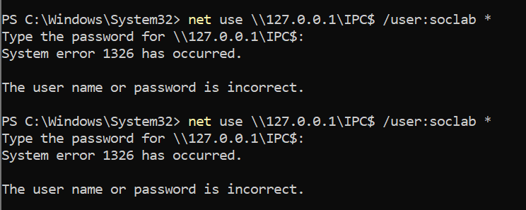
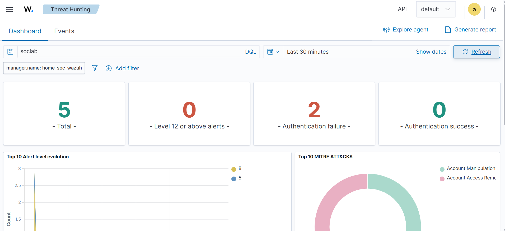
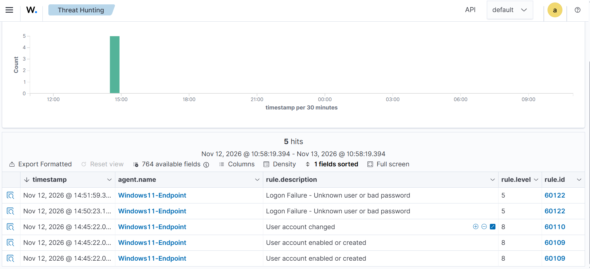
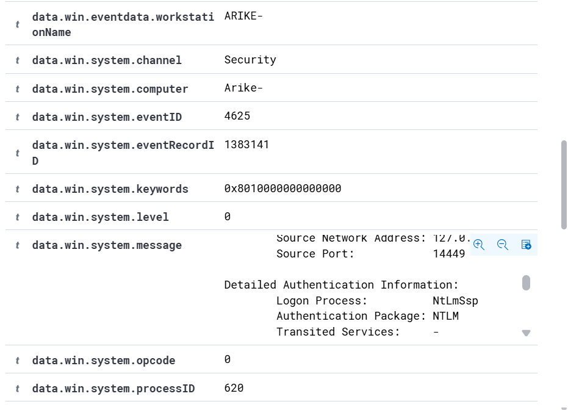

# Wazuh Failed Login Investigation

## Overview

I used my Home SOC lab to investigate failed Windows login attempts in Wazuh.

The goal was to generate a controlled failed login, confirm that Wazuh detected it, and review the event details to understand what happened.

## Failed Login Test

I created a temporary Windows account called `soclab` and generated two failed network login attempts using the wrong password.

```powershell
net use \\127.0.0.1\IPC$ /user:soclab *
```

The attempts returned:

```text
System error 1326 has occurred.
The user name or password is incorrect.
```



## Wazuh Detection

I searched for `soclab` in Wazuh Threat Hunting.

Wazuh detected two authentication failures from my Windows endpoint.



I also reviewed the individual events. Wazuh identified them as:

`Logon Failure - Unknown user or bad password`

The alerts were generated under Wazuh rule `60122` with rule level `5`.



## Event Details

I opened one of the failed login events and found:

- Target user: `soclab`
- Windows Event ID: `4625`
- Source IP: `127.0.0.1`
- Logon Type: `3`
- Logon Process: `NtLmSsp`
- Status: `0xC000006D`
- SubStatus: `0xC000006A`



The event showed that the login attempt came from the same Windows machine and failed because the wrong password was entered.

## Conclusion

The failed login attempts were successfully detected and recorded by Wazuh.

This project helped me practice using a SIEM to search for authentication activity, review Windows security events, and investigate the details behind a failed login alert.
